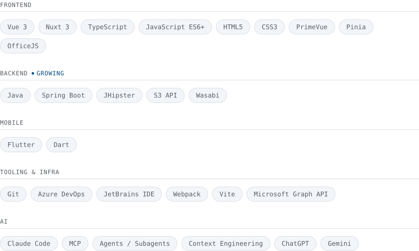

 

## 👋 About me

I'm a **Software Engineer** and **Frontend Specialist**. I build enterprise web applications, mainly in Banking and Corporate, with **Vue 3**, **Nuxt 3** and **TypeScript**, and more recently I work on the backend with **Java** and **Spring Boot**.

My goal is to build complex interfaces that stay readable and maintainable over time, not just today. I work on high-traffic applications with strict security requirements, and I have hands-on experience migrating legacy **VSTO/COM** systems to modern architectures with **OfficeJS** and **Microsoft Graph API**.

Every architectural choice starts from one question: *will this code still be understandable in six months?*

 

## 💼 Experience

**Sydema S.r.l.** — Software Engineer, Banking & Enterprise · *May 2022 – Present*

- Migration of legacy VSTO/COM systems to modern architectures with OfficeJS and Nuxt 3
- Microsoft Graph API integration to automate document processes and manage company data
- Reusable Vue 3 components with PrimeVue, complex state management and granular access control
- Backend with Java, Spring Boot and JHipster: S3 API file uploads to Wasabi buckets, with presigned URLs generated by Spring Boot and direct upload from the client

**Micra Software & Services** — Frontend Developer · *November 2021 – April 2022*

- Web interfaces for business management applications with ExtJS and JavaScript
- Component-based frontend architecture, event handling and REST API integration

 

## 📌 Selected projects

### Open source

| Project | Description | Links |
|---|---|---|
| 💀 **Nuxt Skeletonizer** | Nuxt 4 module that generates skeleton loaders automatically from the existing markup, without duplicating components. An SVG overlay with zero layout shift, native animations, runtime light/dark themes and full SSR and hydration support. | [npm](https://www.npmjs.com/package/nuxt-skeletonizer) · [GitHub](https://github.com/CodeCube0/nuxt-skeletonizer-dev) · [Docs](https://codecube0.github.io/nuxt-skeletonizer-docs/) |
| 🧩 **TinyDI Container** | Dependency injection container for TypeScript with no decorators, no reflect-metadata and no runtime magic. Type-safe tokens, singleton and transient lifetimes, explicit error handling (circular dependencies included) and zero runtime dependencies. | [npm](https://www.npmjs.com/package/tinydi-container) · [GitHub](https://github.com/CodeCube0/TinyDI) · [Docs](https://codecube0.github.io/TinyDI/) |
| 🔗 **RapidGraph** | Type-safe TypeScript wrapper for the Microsoft Graph API that cuts authentication, token handling and rate limiting boilerplate down to a few lines. Application and Delegate modes, batch processing and native Office.js integration. | — |

### Enterprise

| Project | Description |
|---|---|
| ⚖️ **Legal Advisory Platform Plugin** | Microsoft Outlook plugin used by law firms and large companies. Full migration from VSTO/COM to OfficeJS and Nuxt 4, with more than 10 Microsoft Graph API endpoints for document automation, calendar management and secure real-time data access. |
| 🗂️ **Cause Plugin** | Evolution of the GC2 platform toward modular, independent plugins for legal cases and billing. UI designed from scratch: reusable components, centralized state with Pinia and granular RBAC for operator, administrator and supervisor profiles. |

 

## 🧭 How I work

Clarity before code, structure before features.

- **Analysis** — domain, technical constraints and user requirements before writing a line of code
- **Design** — component architecture, TypeScript interfaces and data flow before implementing
- **Development** — typed code, reusable components, logic kept separate from presentation
- **Review** — targeted refactoring, code review and optimization before every production release

Two principles guide the code I write:

- **Clean Code** — explicit names, short functions, dependencies always declared. Good code explains what it does on its own.
- **Principle of Proximity** — logic lives close to where it is used. No premature abstraction: write it first, refactor when it actually makes sense.

 

## 🤖 AI-assisted development

I use AI every day, in every phase of the work. With AI, context matters more than the prompt, so I build and maintain the context the way I maintain code:

- **Organization rules** — security, dependencies and pipeline constraints that apply to every project
- **Hierarchical `CLAUDE.md`** — one per folder: architecture, conventions, decisions already made
- **Custom skills** — repeatable procedures for technical study, review and design systems
- **Human review** — I read every diff, test it and I'm accountable for the output

AI explores codebases, implements from precise instructions, looks for bugs and vulnerabilities, and writes documentation and Azure DevOps pipelines. I define architecture and boundaries, and decide what ships.

 

## 🛠 Tech Stack

<picture>
  <source media="(prefers-color-scheme: dark)" srcset="./assets/tech-stack-dark.svg" />
  
</picture>

 

## 📫 Contact

Open to enterprise software projects, technical consulting on Vue and Nuxt, or simply exchanging ideas on architecture and development.

<a href="https://fabio-fiorucci-portfolio.vercel.app/">🌐 Portfolio</a> &nbsp;•&nbsp;
<a href="https://linkedin.com/in/fabiofiorucci">💼 LinkedIn</a> &nbsp;•&nbsp;
<a href="https://github.com/CodeCube0">💻 GitHub</a> &nbsp;•&nbsp;
<a href="mailto:fabiofiorucci6@gmail.com">📧 Email</a>

