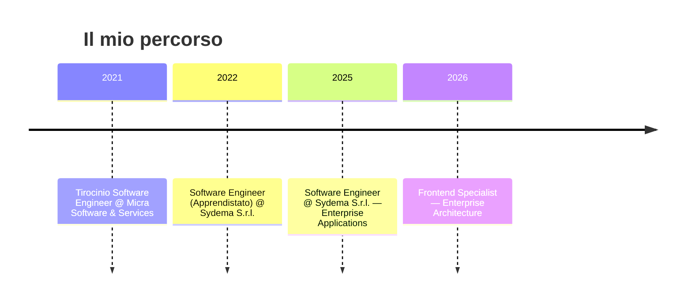

  

 

## 👋 Chi sono

Sono un **Frontend Developer** e **Software Engineer** specializzato nella costruzione di applicazioni enterprise complesse, utilizzate da istituti bancari e grandi organizzazioni.

Mi occupo quotidianamente di:
- 🏗️ progettazione di architetture frontend manutenibili
- 🎯 UI/UX intuitive per flussi di lavoro complessi
- 🔗 integrazione di servizi enterprise e API REST/SOAP
- 🤝 collaborazione con team backend, UX e prodotto

Attualmente lavoro in **Sydema S.r.l.**, dove sviluppo e mantengo applicazioni business-critical con tecnologie web moderne.

 

## 🛠 Tech Stack

**Frontend**

**Mobile**

**Integrazioni & Servizi**

**DevOps & Tools**

 

## 💼 Percorso Professionale

 

## 🎯 Focus Attuale

<table>
<tr>
<td>

🏛️ Enterprise Frontend Architecture
🧩 Vue 3 Composition API
⚡ Nuxt Applications

</td>
<td>

🔌 Microsoft Graph Integrations
📧 Outlook Add-ins
🤖 AI-assisted Development

</td>
<td>

🚀 Developer Productivity
🧱 Software Maintainability
🧼 Clean Architecture

</td>
</tr>
</table>

 

## 📌 Progetti in evidenza

| Progetto | Descrizione |
|---|---|
| 🏦 **Enterprise Applications** | Applicazioni business-critical per contesti bancari e corporate |
| 📧 **Outlook Add-ins** | Integrazioni Microsoft Outlook con OfficeJS e Graph API |
| 🧱 **Frontend Architecture** | Pattern riutilizzabili e soluzioni frontend scalabili |
| 🤖 **AI Development Workflows** | Sperimentazione su workflow di sviluppo assistiti da AI |

 

## 🌱 Oltre il codice

🏠 Home automation & domotica &nbsp;|&nbsp; 🐕 Dog training & agility &nbsp;|&nbsp; 📚 Apprendimento continuo &nbsp;|&nbsp; 🤝 Team collaboration

 

## 🎓 Formazione

**ITS Umbria Smart Academy** — Diploma Tecnico Superiore (EQF 5)
Specializzazione in Tecnologie Digitali per l'Industria 4.0

 

## 📊 GitHub

 

## 📫 Contatti

<a href="https://fabio-fiorucci-portfolio.vercel.app/">🌐 Portfolio</a> &nbsp;•&nbsp;
<a href="https://linkedin.com/in/fabiofiorucci">💼 LinkedIn</a> &nbsp;•&nbsp;
<a href="https://github.com/CodeCube0">💻 GitHub</a> &nbsp;•&nbsp;
<a href="mailto:fabiofiorucci6@gmail.com">📧 Email</a>

  

### Building software that is scalable, maintainable and enjoyable to use.

