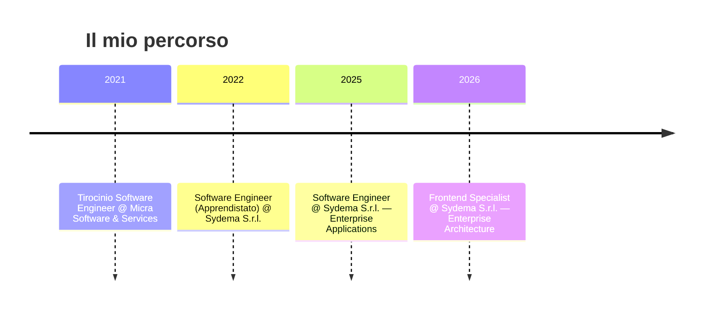

 

## 👋 Chi sono

Sono un **Frontend Developer** e **Software Engineer** specializzato nella costruzione di applicazioni enterprise complesse, utilizzate da istituti bancari e grandi organizzazioni.

Mi occupo quotidianamente di:
- 🏗️ progettazione di architetture frontend manutenibili
- 🎯 UI/UX intuitive per flussi di lavoro complessi
- 🔗 integrazione di servizi enterprise e API REST/SOAP
- 🤝 collaborazione con team backend, UX e prodotto

Attualmente lavoro in **Sydema S.r.l.**, dove sviluppo e mantengo applicazioni business-critical con tecnologie web moderne.

 

## 📌 Progetti in evidenza

| Progetto | Descrizione |
|---|---|
| 🏦 **Enterprise Applications** | Applicazioni business-critical per contesti bancari e corporate, in produzione da anni |
| 📧 **Outlook Add-ins** | Add-in Microsoft Outlook con OfficeJS e Graph API per flussi di lavoro aziendali |
| 🧱 **Frontend Architecture** | Pattern e componenti riutilizzabili adottati su più applicazioni |
| 🤖 **AI Development Workflows** | Sperimentazione di workflow di sviluppo assistiti da AI per velocizzare la delivery senza rinunciare alla qualità |

 

## 🛠 Tech Stack

**Frontend**

**Mobile**

**Integrazioni & Servizi**

**DevOps & Tools**

 

## 💼 Percorso Professionale

 

## 🌱 Oltre il codice

🏠 Home automation & domotica &nbsp;|&nbsp; 🐕 Dog training & agility

 

## 🎓 Formazione

**ITS Umbria Smart Academy** — Diploma Tecnico Superiore (EQF 5)
Specializzazione in Tecnologie Digitali per l'Industria 4.0

 

## 📊 GitHub

 

## 📫 Contatti

<a href="https://fabio-fiorucci-portfolio.vercel.app/">🌐 Portfolio</a> &nbsp;•&nbsp;
<a href="https://linkedin.com/in/fabiofiorucci">💼 LinkedIn</a> &nbsp;•&nbsp;
<a href="https://github.com/CodeCube0">💻 GitHub</a> &nbsp;•&nbsp;
<a href="mailto:fabiofiorucci6@gmail.com">📧 Email</a>

  

### Costruisco software scalabile, mantenibile e piacevole da usare.

